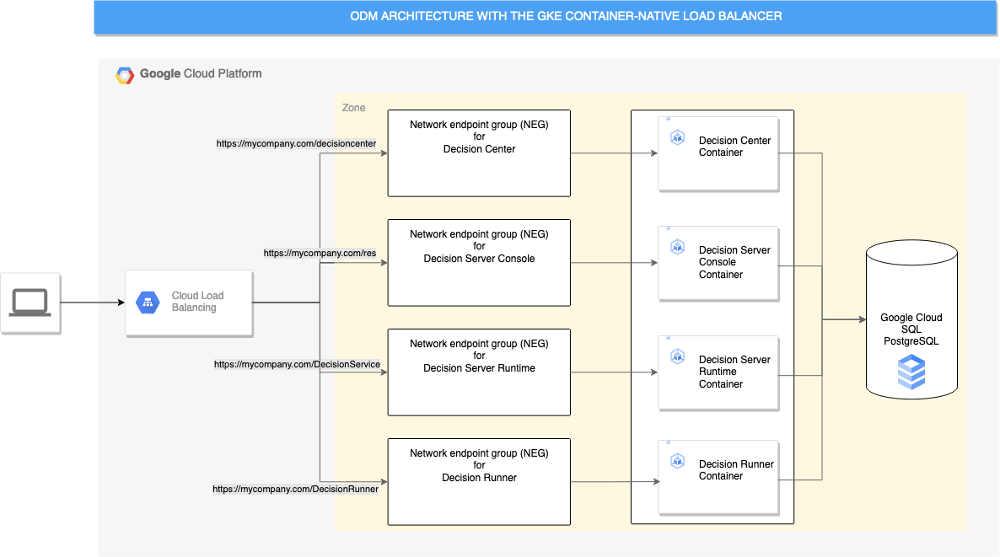
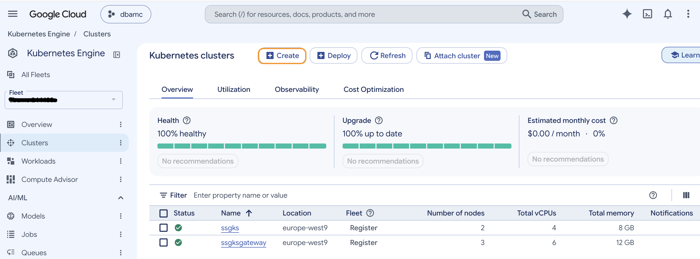
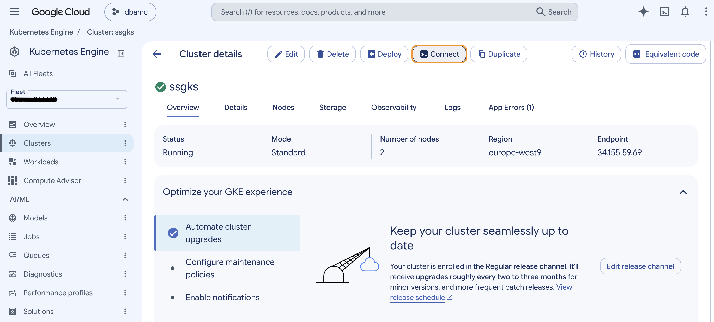
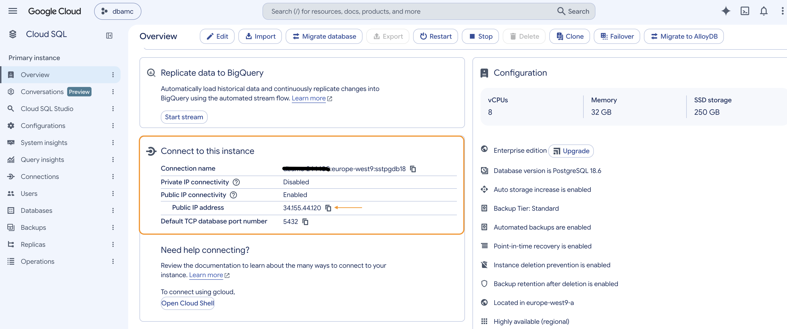
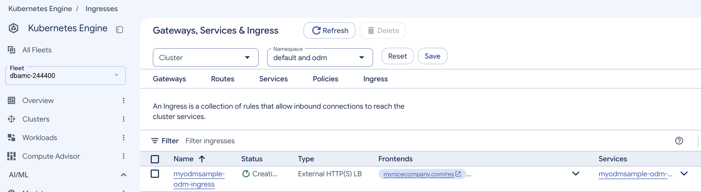
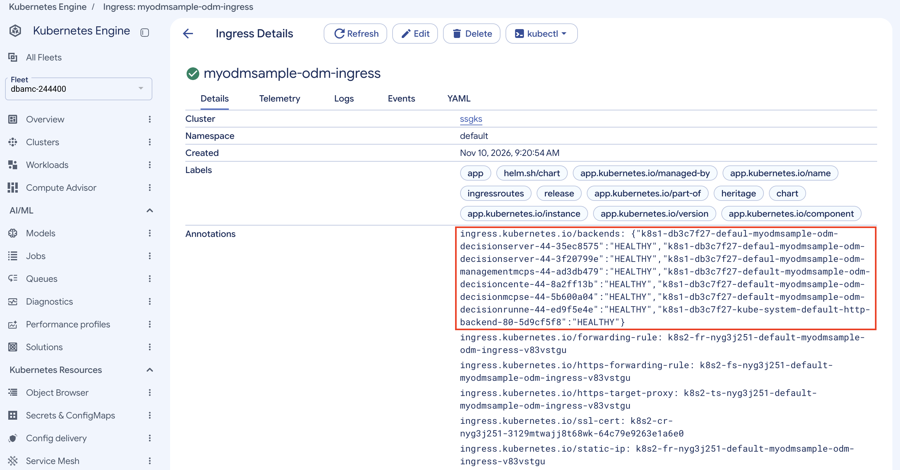
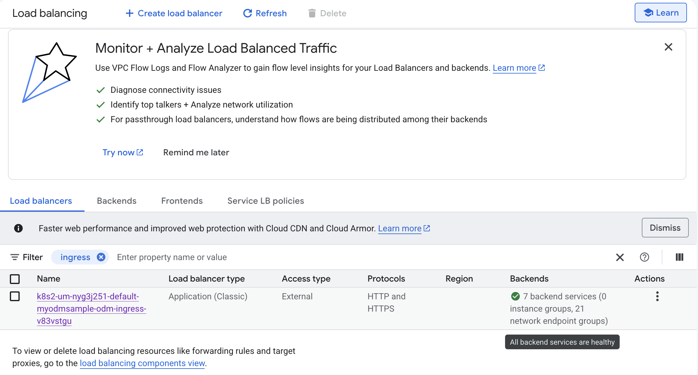
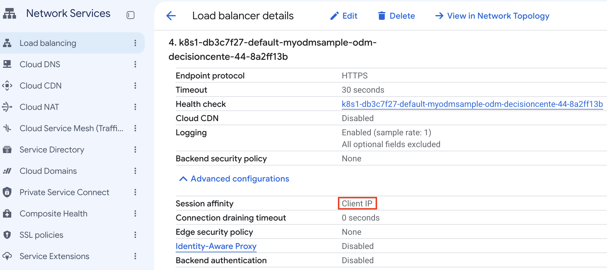
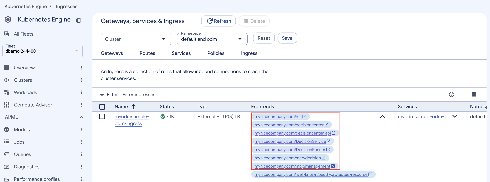

# Deploying IBM Operational Decision Manager on Google GKE

This project demonstrates how to deploy an IBM® Operational Decision Manager (ODM) clustered topology using the [container-native load balancer of GKE](https://cloud.google.com/kubernetes-engine/docs/concepts/container-native-load-balancing).

The ODM services will be exposed using the Ingress provided by the ODM on Kubernetes Helm chart.
This deployment implements Kubernetes and Docker technologies.
Here is the Google Cloud home page: <https://cloud.google.com>



The ODM on Kubernetes Docker images are available in the [IBM Entitled Registry](https://www.ibm.com/cloud/container-registry). The ODM Helm chart is available in the [IBM Helm charts repository](https://github.com/IBM/charts).
> [!IMPORTANT]
> **Deployment Options:**
>
> There are two ways to expose ODM services on GKE:
>
> 1. **GKE Ingress (Default - Documented in this README):** Uses the [GKE Ingress controller](https://cloud.google.com/kubernetes-engine/docs/concepts/ingress) with container-native load balancing. This is the standard approach documented in the steps below.
>
> 2. **GKE Gateway API (Recommended for Advanced Features):** Uses the [GKE Gateway API](https://cloud.google.com/kubernetes-engine/docs/concepts/gateway-api) which provides more advanced routing capabilities, better session affinity management, and is the future direction for Kubernetes networking. See the [GKE Gateway API deployment guide](README_GATEWAY.md).

## Included components

The project comes with the following components:

- [IBM Operational Decision Manager](https://www.ibm.com/docs/en/odm/9.6.0?topic=operational-decision-manager-certified-kubernetes-960)
- [Google Kubernetes Engine (GKE)](https://cloud.google.com/kubernetes-engine)
- [Google Cloud SQL for PostgreSQL](https://cloud.google.com/sql)
- [IBM Usage Metering Service](https://github.com/IBM/charts/blob/master/repo/ibm-helm/ibm-usage-metering.md)

## Tested environment

The commands and tools have been tested on macOS and Linux.

## Prerequisites

First, install the following software on your machine:

- [gcloud CLI](https://cloud.google.com/sdk/gcloud)
- [kubectl](https://kubernetes.io/docs/tasks/tools/)
- [gke-gcloud-auth-plugin](https://cloud.google.com/kubernetes-engine/docs/how-to/cluster-access-for-kubectl#install_plugin): required by `kubectl` to authenticate to GKE clusters.
- [Helm v4](https://helm.sh/docs/intro/install/)

Then, perform the following tasks:

1. Create a Google Cloud account by connecting to the Google Cloud Platform [console](https://console.cloud.google.com/). When prompted to sign in, create a new account by clicking **Create account**.

2. [Create a Google Cloud project](https://cloud.google.com/resource-manager/docs/creating-managing-projects)

3. [Manage the associated billing](https://cloud.google.com/billing/docs/how-to/modify-project#confirm_billing_is_enabled_on_a_project).

Without the relevant billing level, some Google Cloud resources will not be created.

> [!NOTE]
> Prerequisites and software supported by ODM 9.6.0 are listed on [the Detailed System Requirements page](https://www.ibm.com/support/pages/ibm-operational-decision-manager-detailed-system-requirements).

## Steps to deploy ODM on Kubernetes from Google GKE

<!-- TOC depthfrom:3 depthto:3 -->

- [Prepare your GKE instance 30 min](#1-prepare-your-gke-instance-30-min)
- [Create the Google Cloud SQL PostgreSQL instance 10 min](#2-create-the-google-cloud-sql-postgresql-instance-10-min)
- [Prepare your environment for the ODM installation 10 min](#3-prepare-your-environment-for-the-odm-installation-10-min)
- [Manage a digital certificate 2 min](#4-manage-a-digital-certificate-2-min)
- [Install the ODM release 10 min](#5-install-the-odm-release-10-min)
- [Access ODM services](#6-access-odm-services)
- [Track ODM usage](#7-track-odm-usage)

<!-- /TOC -->

### 1. Prepare your GKE instance (30 min)

Refer to the [GKE quickstart](https://cloud.google.com/kubernetes-engine/docs/quickstart) for more information.

#### Log into Google Cloud

After installing the `gcloud` tool, run the initialization wizard. This will authenticate your account, set your active project, and configure your default region and zone (e.g. europe-west9 / europe-west9-b):
```shell
gcloud init
```

If you have already initialized your environment and only need to re-authenticate an expired session or switch user accounts, use the login command instead:
```shell
gcloud auth login
```

To inspect your existing configuration, you can run this command:
```shell
gcloud config list
```

#### Create a GKE cluster

There are several [types of clusters](https://docs.cloud.google.com/kubernetes-engine/docs/concepts/configuration-overview#availability).
In this article, we chose to create a [regional cluster](https://cloud.google.com/kubernetes-engine/docs/how-to/creating-a-regional-cluster).

Run the following command to create a highly available regional cluster with [autoscaling](https://cloud.google.com/kubernetes-engine/docs/how-to/cluster-autoscaler) enabled. The cluster starts with 6 nodes (2 in each of the 3 zones present in the region) and can scale up to 16 nodes in total:

```shell
gcloud container clusters create <CLUSTER_NAME> \
  --location=<REGION (ex: europe-west9)> \
  --release-channel=regular \
  --cluster-version=1.35 \
  --enable-autoscaling \
  --num-nodes=2 \
  --total-min-nodes=1 \
  --total-max-nodes=16
```

> [!TIP]
> The cluster is created in the project selected during `gcloud init`.
> - To use another project, run `gcloud config set project <PROJECT_ID>` first.
> - To use another region, change the `--location` value above. Available regions can be listed with `gcloud compute regions list`.

> [!NOTE]
> You can also create your cluster from the Google Cloud Platform using the **Kubernetes Engine** > **Clusters** panel and clicking the **Create** button
> 

#### Set up your environment

When you create the cluster with the `gcloud` CLI, your `kubeconfig` is updated automatically and `kubectl` targets the new cluster.

If you created the cluster from the Google Cloud console or from another machine, or if you work with several clusters, run the following command to create or switch to the `kubeconfig` entry of your cluster:

```shell
gcloud container clusters get-credentials <CLUSTER_NAME> --location=<REGION (ex: europe-west9)>
```

> [!NOTE]
> You can also retrieve the command line to configure `kubectl` from the Google Cloud Console using the **Kubernetes Engine** > **Clusters** panel, clicking the dedicated cluster to go into its details, and then clicking the **Connect** button.
> 

- Check your environment

  If your environment is set up correctly, you should be able to get the cluster information by running the following command:

  ```shell
  kubectl cluster-info
  ```

### 2. Create the Google Cloud SQL PostgreSQL instance (10 min)

#### Create the database instance

We will use the Google Cloud Platform console to create the database instance.

- Go to the [SQL context](https://console.cloud.google.com/sql), and then click the **CREATE INSTANCE** button.
- Click **Choose PostgreSQL** button.
  - Choose your Cloud SQL edition (`Enterprise Plus` / `Enterprise`) based on your needs.
  - Database version: `PostgreSQL 18`
  - Instance ID: `<YourInstanceName>`
  - Password: `<PASSWORD>` - Take note of this password.
  - Region: `<REGION>` - Must be the same zone as the cluster for the communication to be optimal between the database and the ODM instance.
  - Eventually select **Multiple zones** for Zonal availability for redundancy.
  - Expand **Show customization option** and expand **Connections**
    - As *Public IP* is selected by default, in Authorized networks, click the **ADD NETWORK** button, put a name and add *0.0.0.0/0* for Network, acknowledge the risk, and then click **DONE**.
      > NOTE: It is not recommended to use a public IP. In a production environment, you should use a private IP.
- Click **Create Instance**.

After the database instance is created, you can drill on the SQL instance overview to retrieve needed information to connect to this instance, like the IP address and the connection name. Take note of the **Public IP address**.



#### Create the database secret for Google Cloud SQL PostgreSQL

To secure access to the database, you must create a secret that encrypts the database user and password before you install the Helm release.

```shell
kubectl create secret generic odmdbsecret \
  --from-literal=db-user=postgres \
  --from-literal=db-password=<PASSWORD>
```

Where:

- `<PASSWORD>` is the database password (PASSWORD set during the PostgreSQL instance creation above)

### 3. Prepare your environment for the ODM installation (10 min)

To get access to the ODM material, you need an IBM entitlement key to pull the images from the IBM Entitled Registry.

#### Retrieve your entitled registry key

- Log in to [MyIBM Container Software Library](https://myibm.ibm.com/products-services/containerlibrary) with the IBMid and password that are associated with the entitled software.

- In the Container software library tile, verify your entitlement on the **View library** page, and then go to **Get entitlement key** to retrieve the key.

#### Create a pull secret by running a kubectl create secret command

```shell
kubectl create secret docker-registry ibm-entitlement-key \
        --docker-server=cp.icr.io \
        --docker-username=cp \
        --docker-password='<API_KEY_GENERATED>'
```

Where `<API_KEY_GENERATED>` is the entitlement key from the previous step. Make sure you enclose the key in quotes.

> Note:
>
> 1. The **cp.icr.io** value for the docker-server parameter is the only registry domain name that contains the images. You must set the *docker-username* to **cp** to use an entitlement key as *docker-password*.
> 2. The `ibm-entitlement-key` secret name will be used for the `image.pullSecrets` parameter when you run a Helm install of your containers. The `image.repository` parameter is also set by default to `cp.icr.io/cp/cp4a/odm`.

#### Add the public IBM Helm charts repository

```shell
helm repo add ibm-helm https://raw.githubusercontent.com/IBM/charts/master/repo/ibm-helm
helm repo update
```

#### Check you can access ODM charts

```shell
helm search repo ibm-odm-prod
NAME                  CHART VERSION   APP VERSION     DESCRIPTION
ibm-helm/ibm-odm-prod 26.3.0          9.7.0.0         IBM Operational Decision Manager
```

### 4. Manage a digital certificate (2 min)

#### (Optional) Generate a self-signed certificate

In this step, you will generate a certificate to be used by the GKE load balancer.

If you do not have a trusted certificate, you can use OpenSSL and other cryptography and certificate management libraries to generate a certificate file and a private key to define the domain name and to set the expiration date. The following command creates a self-signed certificate (`.crt` file) and a private key (`.key` file) that accept the domain name *mynicecompany.com*. The expiration is set to 1000 days:

```shell
openssl req -x509 -nodes -days 1000 -newkey rsa:2048 -keyout mynicecompany.key \
        -out mynicecompany.crt -subj "/CN=mynicecompany.com/OU=it/O=mynicecompany/L=Paris/C=FR"
```

#### Create a TLS secret with these keys

```shell
kubectl create secret tls mynicecompany-tls-secret --key mynicecompany.key --cert mynicecompany.crt
```

The certificate must be the same as the one you used to enable TLS connections in your ODM release. For more information, see [Server certificates](https://www.ibm.com/docs/en/odm/9.6.0?topic=production-defining-security-certificate) and [Working with certificates and SSL](https://docs.oracle.com/cd/E19830-01/819-4712/ablqw/index.html).

### 5. Install the ODM release (10 min)

#### Install an ODM Helm release

The ODM services will be exposed with an Ingress that uses the previously created `mynicecompany` certificate.
It automatically creates an HTTPS GKE load balancer. The ODM internal TLS stays enabled (the chart default), so the traffic between the load balancer and the ODM pods is also encrypted.

- Get the [gcp-values.yaml](./gcp-values.yaml) file and replace the following key:

  - `<DB_ENDPOINT>`: the database IP

> [!NOTE]
> You can configure the driversUrl parameter to point to the appropriate version of the Google Cloud SQL PostgreSQL driver. For more information, refer to the [Cloud SQL Connector for Java](https://github.com/GoogleCloudPlatform/cloud-sql-jdbc-socket-factory#cloud-sql-connector-for-java) documentation.

- Install the chart from IBM's public Helm charts repository:

  ```shell
  helm install <release> ibm-helm/ibm-odm-prod -f gcp-values.yaml
  ```

#### Check the topology

Run the following command to check the status of the pods that have been created:

```shell
kubectl get pods
NAME                                                   READY   STATUS    RESTARTS   AGE
<release>-odm-decisioncenter-***                       1/1     Running   0          20m
<release>-odm-decisionmcpserver-***                    1/1     Running   0          20m
<release>-odm-decisionrunner-***                       1/1     Running   0          20m
<release>-odm-decisionserverconsole-***                1/1     Running   0          20m
<release>-odm-decisionserverruntime-***                1/1     Running   0          20m
<release>-odm-managementmcpserver-***                  1/1     Running   0          20m
```

#### Configure the GKE load balancer backends

By default, the GKE Ingress controller talks to the backends and runs its health checks over plain `HTTP`. Because the ODM pods serve `HTTPS`, you must set GKE to use `HTTPS`, and which health check to run, for each ODM service.

This is done with [BackendConfigs](odm-backendconfigs.yaml), one per ODM service, that set an `HTTPS` health check with the correct port and path. The following two annotations must be added to each ODM Kubernetes service:

- `cloud.google.com/backend-config` - [To link the Service to its BackendConfig](https://cloud.google.com/kubernetes-engine/docs/how-to/ingress-configuration#unique_backendconfig_per_service_port).
- `cloud.google.com/app-protocols` - [To set the protocol used between the load balancer and the pods](https://cloud.google.com/kubernetes-engine/docs/how-to/ingress-multi-ssl#https_between_load_balancer_and_application) to `HTTPS`.

For more information, see [Custom health check configuration](https://cloud.google.com/kubernetes-engine/docs/how-to/ingress-features#direct_health).

The Decision Center `BackendConfig` also enables the session affinity. Sticky session is needed for Decision Center: the browser contains a cookie which identifies the user session that is linked to a unique container.
The ODM on Kubernetes Helm chart has a [clientIP](https://kubernetes.io/docs/concepts/services-networking/service/#proxy-mode-ipvs) for the Decision Center session affinity. Unfortunately, GKE does not use it automatically. You will not encounter any issue until you scale up the Decision Center deployment.

- Apply the [BackendConfigs](odm-backendconfigs.yaml):

  ```shell
  kubectl apply -f odm-backendconfigs.yaml
  ```

- Annotate the ODM Services with the BackendConfigs (replace `<release>` with your release name):

  ```shell
  R=<release>
  annotate() {
    kubectl annotate service $R-odm-$1 \
      cloud.google.com/backend-config="{\"ports\":{\"443\":\"$2\"}}" \
      cloud.google.com/app-protocols="{\"$3\":\"HTTPS\"}"
  }

  annotate decisioncenter        dc-backendconfig            dc-svc-port
  annotate decisionserverconsole dsc-backendconfig           dsc-svc-port
  annotate decisionserverruntime dsr-backendconfig           dsr-svc-port
  annotate decisionrunner        dr-backendconfig            dr-svc-port
  annotate decisionmcpserver     decisionmcp-backendconfig   mcp-svc-port
  annotate managementmcpserver   managementmcp-backendconfig mcp-svc-port

  # If you use dedicated Decision Server Runtime services (decisionServerRuntime.dedicated in the values file),
  # uncomment the following line for each of them. Replace <name> with the name of the dedicated service.
  # They reuse the BackendConfig of the Decision Server Runtime.
  # annotate decisionserverruntime-<name> dsr-backendconfig dsr-svc-port
  ```

  GKE then updates the existing backend services one by one.

#### Check the Ingress and the GKE LoadBalancer

To get the status of the current deployment, go to the [Kubernetes Engine / Services & Ingress Panel](https://console.cloud.google.com/kubernetes/ingresses) in the console.

The Ingress remains in the state *Creating ingress* until the pods are up and running and the backends are in a healthy state. The backend services are first created with the HTTP protocol, then switched to HTTPS once GKE has read the Service annotations. The whole update procedure can take 20 to 30 minutes.



In the Ingress details, you should eventually get a *HEALTHY* state on all backends.
This panel also provides some logs on the load balancer activity.
When the Ingress shows an OK status and all backends are *HEALTHY*, all ODM services can be accessed.



You can also check the backends from the command line:

```shell
kubectl get ingress <release>-odm-ingress \
  -o jsonpath='{.metadata.annotations.ingress\.kubernetes\.io/backends}' | tr ',' '\n'
```

An example where all backends are in *HEALTHY* state:

```shell
{"k8s1-db3c7f27-defaul-myodmsample-odm-decisionserver-44-35ec8575":"HEALTHY"
"k8s1-db3c7f27-defaul-myodmsample-odm-decisionserver-44-3f20799e":"HEALTHY"
"k8s1-db3c7f27-defaul-myodmsample-odm-managementmcps-44-ad3db479":"HEALTHY"
"k8s1-db3c7f27-default-myodmsample-odm-decisioncente-44-8a2ff13b":"HEALTHY"
"k8s1-db3c7f27-default-myodmsample-odm-decisionmcpse-44-5b600a04":"HEALTHY"
"k8s1-db3c7f27-default-myodmsample-odm-decisionrunne-44-ed9f5e4e":"HEALTHY"
"k8s1-db3c7f27-kube-system-default-http-backend-80-5d9cf5f8":"HEALTHY"}
```

You can also check the [load balancer status](https://console.cloud.google.com/net-services/loadbalancing/list/loadBalancers). It provides information about the backend using the service health check.



When the load balancer becomes available, you can verify for Decision Center that the session affinity is set to `ClientIP` in the Load Balancer details using the Google Cloud Console.



### 6. Access ODM services

In a real enterprise use case, to access the mynicecompany.com domain name, you have to deal with [Google Managed Certificate](https://cloud.google.com/load-balancing/docs/ssl-certificates/google-managed-certs) and [Google Cloud DNS](https://cloud.google.com/dns).

In this trial, we use a self-signed certificate. So, there is no extra charge like certificate and domain purchase.
We only have to manage a configuration to simulate the mynicecompany.com access.

- Get the EXTERNAL-IP with the command line:

  ```shell
  kubectl get ingress <release>-odm-ingress -o jsonpath='{.status.loadBalancer.ingress[].ip}'
  ```

- Edit your /etc/hosts file and add the following entry:

  ```shell
  <EXTERNAL-IP> mynicecompany.com
  ```

- You can now access all ODM services with the following URLs:

<!-- markdown-link-check-disable -->
  | SERVICE NAME | URL | USERNAME/PASSWORD
  | --- | --- | ---
  | Decision Server Console | <https://mynicecompany.com/res> | odmAdmin/odmAdmin
  | Decision Center | <https://mynicecompany.com/decisioncenter> | odmAdmin/odmAdmin
  | Decision Center REST-API | <https://mynicecompany.com/decisioncenter-api> | odmAdmin/odmAdmin
  | Decision Server Runtime | <https://mynicecompany.com/DecisionService> | odmAdmin/odmAdmin
  | Decision Runner | <https://mynicecompany.com/DecisionRunner> | odmAdmin/odmAdmin
<!-- markdown-link-check-enable -->

> [!NOTE]
> You can also click the Ingress frontends accessible from the Google Cloud console under the [Kubernetes Engine/Services & Ingress Details Panel](https://console.cloud.google.com/kubernetes/ingresses).
> 

### 7. Track ODM usage

#### 7.1 Install the IBM Usage Metering Service

The IBM Usage Metering Service (UMS) is a critical component that gathers metrics to monitor compliance and create reports. It captures business value metrics for auditing purposes, visualizes metric usage in reporting tools, and sends the information to IBM Software Central.

The IBM License Service (ILS) discovers the software that is installed in your infrastructure and generates reports containing contractual details. These metrics directly affect licensing obligations and are required for calculating license usage in compliance with IBM licensing requirements.

An ILS side-car must be activated when installing UMS. This allows UMS to capture two metrics: contractual metrics for compliance purposes, and adoption metrics for various scenarios related to usage analysis.

**Prerequisites:**
- Cluster-admin permissions or appropriate RBAC roles
- Target namespace must exist before installation
- ODM 9.6.0 or later installed

**Important Requirements:**
- From ODM 9.6.0 onwards, UMS **must** be installed in the same namespace as ODM
- ODM reports usage metrics to UMS through a scheduled CronJob
- If UMS is not installed, the CronJob will fail when it runs

**Installation:**

For detailed installation and configuration instructions, see [Installing the usage metering service](https://www.ibm.com/docs/en/odm/9.6.0?topic=metrics-installing-metering).

In this tutorial, we assume that ODM, UMS, and ILS are installed in the same namespace: `default`. The ILS side car is enabled with *namespace scope* to monitor only `default` namespace.

**Troubleshooting:**

If the CronJob fails, check the pod logs:
```bash
kubectl logs -n <namespace> -l job-name=<cronjob-name>
```

**Configuration Options:**

After installing UMS, choose one of the following configuration modes based on your environment:

1. **Online Mode** (Recommended): Automatic data transmission to IBM Software Central
2. **Offline Mode** (Air-gapped): Manual data download and upload process

##### 7.1.1 Online Mode (Recommended)

In online mode, the Usage Metering Service automatically sends usage data to IBM Software Central on a scheduled basis. This is the recommended configuration for environments with internet connectivity.

**Key Features:**
- Automatic data transmission every 24 hours
- No manual intervention required after initial setup
- Automatic retry on transmission failures

**Configuration Requirements:**
- IBM Entitlement Key (required for authentication)
- Network connectivity to IBM Software Central (`swc.saas.ibm.com`)

For complete step-by-step instructions on configuring online mode, refer to:

📖 **[Automatic data transmission to IBM Software Central](https://www.ibm.com/docs/en/odm/9.6.0?topic=metrics-automatic-data-transmission)**

This documentation covers:
- Creating the IBM Entitlement Key secret
- Configuring the IBMUsageMetering instance
- Verifying the configuration
- Monitoring data transmission
- Troubleshooting common issues

##### 7.1.2 Offline Mode (Air-gapped Environments)

For offline/air-gapped environments where the Usage Metering Service cannot connect directly to IBM Software Central, you need to manually download and upload usage data.

**Step 1: Expose the Usage Metering Service**

The UMS service `ibm-usage-metering-instance` is only reachable inside the cluster.

The [ums-ingress.yaml](./ums-ingress.yaml) file exposes them in the same way as ODM: an Ingress creates an HTTPS GKE load balancer that uses the `ibm-usage-metering-instance` TLS secret created by UMS, and the traffic to the UMS pods is also encrypted. The services are routed by host name: `ums.mynicecompany.com` to the port `8080` and `ls.mynicecompany.com` to the port `8082`.

Apply it in the namespace where UMS is installed:

```bash
kubectl apply -f ums-ingress.yaml
```

Wait for the Ingress to get an address and for its backends to be in a *HEALTHY* state:

```bash
kubectl get ingress ums-ingress
kubectl get ingress ums-ingress \
  -o jsonpath='{.metadata.annotations.ingress\.kubernetes\.io/backends}' | tr ',' '\n'
```

Get the Ingress address and add the following entry to your `/etc/hosts` file:

```bash
export NAMESPACE=default
UMS_IP=$(kubectl get ingress ums-ingress -n "${NAMESPACE}" -o jsonpath='{.status.loadBalancer.ingress[0].ip}')
echo "${UMS_IP} ums.mynicecompany.com ls.mynicecompany.com"
```

**Step 2: Download Usage Data**

Retrieve the metering service data through the load balancer:

```bash
UMS_TOKEN=$(kubectl get secret ibm-usage-metering-upload-token -n "${NAMESPACE}" -o jsonpath='{.data.token}' 2>/dev/null | base64 -d || echo "")
curl -k --output "swc_payload.tar.gz" \
     --header "Authorization: Bearer ${UMS_TOKEN}" \
     --url "https://ums.mynicecompany.com/api/v1/swc"
```

The `swc_payload.tar.gz` contains the following files:
- manifest.json
- usage.json

The `usage.json` file contains both adoption (`"metricType": "adoption"`) and contractual (`"metricType": "contract"`) metrics.

To view the UMS Data page and the UMS Serviceability page, open this URL in a browser:

```bash
echo "https://ums.mynicecompany.com/status?token=${UMS_TOKEN}"
```

- **UMS Data tab**: It displays the condition `Namespace Scope is enabled. Current cluster configuration restricts License Service to query pods that are only in these namespaces: default`. It also displays the contractual metrics of the product, such as PVU or VPC, for each Decision component.
- **UMS Serviceability tab**: It displays the details of the last five adoption payloads, the number of exports to IBM Software Central, and other information.

To retrieve the licensing snapshot from the IBM License Service, run:

```bash
curl -k "https://ls.mynicecompany.com/snapshot?token=${UMS_TOKEN}" --output ils_snapshot_report.zip
```

> [!NOTE]
> The certificate presented by the load balancer is the self-signed one generated by UMS, hence `curl -k`.

**Step 3: Upload to IBM Software Central**

After downloading the `swc_payload.tar.gz` file, you need to upload it to IBM Software Central to report your usage metrics. The upload process requires authentication with your IBM ID and must be performed from a machine with internet access.

For detailed instructions on how to upload the usage data file to IBM Software Central, including authentication steps and troubleshooting, refer to:

📖 **[Uploading usage metrics to IBM Software Central](https://www.ibm.com/docs/en/odm/9.6.0?topic=metrics-uploading-usage-software-central)**

**Additional Resources:**

For general information about collecting and sending usage metrics, see:
📖 **[Collecting and sending usage metrics](https://www.ibm.com/docs/en/odm/9.6.0?topic=production-collecting-sending-usage-metrics)**

## Troubleshooting

If your ODM instances are not running properly, refer to [our dedicated troubleshooting page](https://www.ibm.com/docs/en/odm/9.6.0?topic=960-troubleshooting).

## Getting Started with IBM Operational Decision Manager for Containers

Get hands-on experience with IBM Operational Decision Manager in a container environment by following this [Getting started tutorial](https://github.com/DecisionsDev/odm-for-container-getting-started/blob/master/README.md).

## License

[Apache 2.0](/LICENSE)
