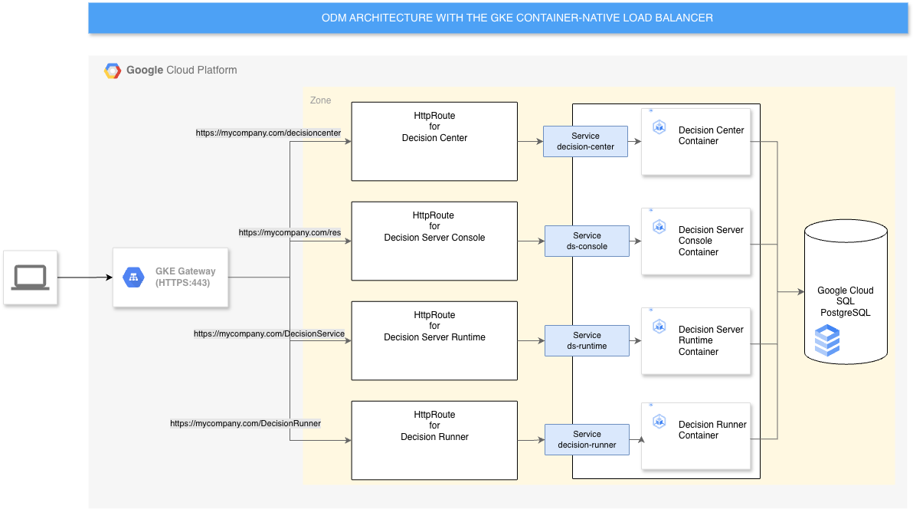
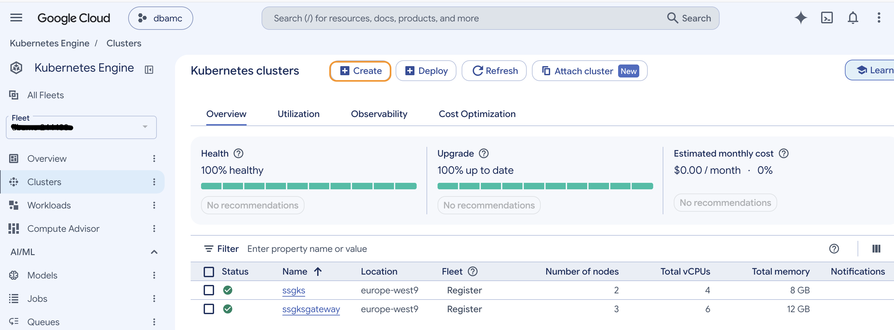
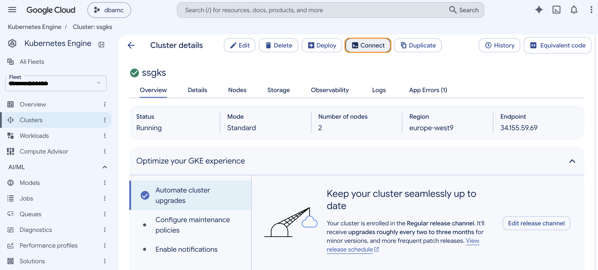
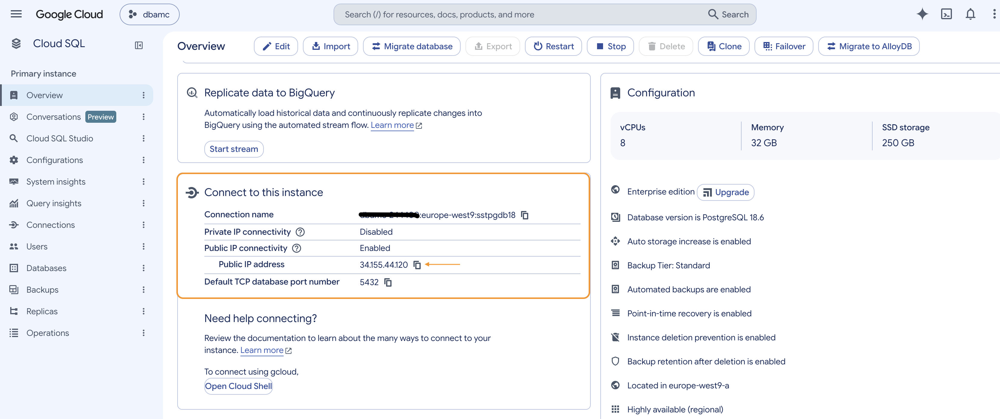

# Deploying IBM Operational Decision Manager on Google GKE

This project demonstrates how to deploy an IBM® Operational Decision Manager (ODM) clustered topology using the [Gateway API with GKE](https://cloud.google.com/kubernetes-engine/docs/concepts/gateway-api).

The ODM services will be exposed using the Gateway API provided by GKE's native Gateway Controller.
This deployment implements Kubernetes and Docker technologies.
Here is the Google Cloud home page: <https://cloud.google.com>



The ODM on Kubernetes Docker images are available in the [IBM Entitled Registry](https://www.ibm.com/cloud/container-registry). The ODM Helm chart is available in the [IBM Helm charts repository](https://github.com/IBM/charts).

## Included components

The project comes with the following components:

- [IBM Operational Decision Manager](https://www.ibm.com/docs/en/odm/9.6.0?topic=operational-decision-manager-certified-kubernetes-960)
- [Google Kubernetes Engine (GKE)](https://cloud.google.com/kubernetes-engine)
- [Google Cloud SQL for PostgreSQL](https://cloud.google.com/sql)
- [IBM License Service](https://github.com/IBM/ibm-licensing-operator)

## Tested environment

The commands and tools have been tested on macOS and Linux.

## Prerequisites

First, install the following software on your machine:

- [gcloud CLI](https://cloud.google.com/sdk/gcloud)
- [kubectl](https://kubernetes.io/docs/tasks/tools/)
- [gke-gcloud-auth-plugin](https://cloud.google.com/kubernetes-engine/docs/how-to/cluster-access-for-kubectl#install_plugin): required by `kubectl` to authenticate to GKE clusters.
- [Helm v3](https://helm.sh/docs/intro/install/)

Then, perform the following tasks:

1. Create a Google Cloud account by connecting to the Google Cloud Platform [console](https://console.cloud.google.com/). When prompted to sign in, create a new account by clicking **Create account**.

2. [Create a Google Cloud project](https://cloud.google.com/resource-manager/docs/creating-managing-projects)

3. [Manage the associated billing](https://cloud.google.com/billing/docs/how-to/modify-project#confirm_billing_is_enabled_on_a_project).

Without the relevant billing level, some Google Cloud resources will not be created.

> [!NOTE]
> Prerequisites and software supported by ODM 9.6.0 are listed on [the Detailed System Requirements page](https://www.ibm.com/support/pages/ibm-operational-decision-manager-detailed-system-requirements).

## Steps to deploy ODM on Kubernetes from Google GKE

<!-- TOC depthfrom:3 depthto:3 -->

- [1. Prepare your GKE instance 30 min](#1-prepare-your-gke-instance-30-min)
- [2. Create the Google Cloud SQL PostgreSQL instance 10 min](#2-create-the-google-cloud-sql-postgresql-instance-10-min)
- [3. Prepare your environment for the ODM installation 10 min](#3-prepare-your-environment-for-the-odm-installation-10-min)
- [4. Manage a digital certificate 2 min](#4-manage-a-digital-certificate-2-min)
- [5. Install the ODM release 10 min](#5-install-the-odm-release-10-min)
- [6. Access ODM services](#6-access-odm-services)
- [7. Track ODM usage](#7-track-odm-usage)
- [Troubleshooting](#troubleshooting)
- [Getting Started with IBM Operational Decision Manager for Containers](#getting-started-with-ibm-operational-decision-manager-for-containers)

<!-- /TOC -->

### 1. Prepare your GKE instance (30 min)

Refer to the [GKE quickstart](https://cloud.google.com/kubernetes-engine/docs/quickstart) for more information.

#### Log into Google Cloud

After installing the `gcloud` tool, run the initialization wizard. This will authenticate your account, set your active project, and configure your default region and zone (e.g. europe-west9 / europe-west9-b):
```shell
gcloud init
```

If you have already initialized your environment and only need to re-authenticate an expired session or switch user accounts, use the login command instead:
```shell
gcloud auth login
```

To inspect your existing configuration, you can run this command:
```shell
gcloud config list
```

#### Create a GKE cluster

There are several [types of clusters](https://docs.cloud.google.com/kubernetes-engine/docs/concepts/configuration-overview#availability).
In this article, we chose to create a [regional cluster](https://cloud.google.com/kubernetes-engine/docs/how-to/creating-a-regional-cluster).

Run the following command to create a highly available regional cluster with [autoscaling](https://cloud.google.com/kubernetes-engine/docs/how-to/cluster-autoscaler) enabled. The cluster starts with 6 nodes (2 in each of the 3 zones present in the region) and can scale up to 16 nodes in total. The `--gateway-api=standard` option enables the GKE Gateway API on the cluster:

```shell
gcloud container clusters create <CLUSTER_NAME> \
  --location=<REGION (ex: europe-west9)> \
  --release-channel=regular \
  --cluster-version=1.35 \
  --enable-autoscaling \
  --num-nodes=2 \
  --total-min-nodes=1 \
  --total-max-nodes=16 \
  --gateway-api=standard
```

> [!TIP]
> The cluster is created in the project selected during `gcloud init`.
> - To use another project, run `gcloud config set project <PROJECT_ID>` first.
> - To use another region, change the `--location` value above. Available regions can be listed with `gcloud compute regions list`.

> [!NOTE]
> You can also create your cluster from the Google Cloud Platform using the **Kubernetes Engine** > **Clusters** panel and clicking the **Create** button
> 

#### Set up your environment

When you create the cluster with the `gcloud` CLI, your `kubeconfig` is updated automatically and `kubectl` targets the new cluster. 

If you created the cluster from the Google Cloud console or from another machine, or if you work with several clusters, run the following command to create or switch to the `kubeconfig` entry of your cluster:

```shell
gcloud container clusters get-credentials <CLUSTER_NAME> --location=<REGION (ex: europe-west9)>
```

> [!NOTE]
> You can also retrieve the command line to configure `kubectl` from the Google Cloud Console using the **Kubernetes Engine** > **Clusters** panel, clicking the dedicated cluster to go into its details, and then clicking the **Connect** button.
> 

- Check your environment

  If your environment is set up correctly, you should be able to get the cluster information by running the following command:

  ```shell
  kubectl cluster-info
  ```

### 2. Create the Google Cloud SQL PostgreSQL instance (10 min)

#### Create the database instance

We will use the Google Cloud Platform console to create the database instance.

- Go to the [SQL context](https://console.cloud.google.com/sql), and then click the **CREATE INSTANCE** button.
- Click **Choose PostgreSQL** button.
  - Choose your Cloud SQL edition (`Enterprise Plus` / `Enterprise`) depending on your needs.
  - Database version: `PostgreSQL 18`
  - Instance ID: `<YourInstanceName>`
  - Password: `<PASSWORD>` - Take note of this password.
  - Region: `<REGION>` - Must be the same zone as the cluster for the communication to be optimal between the database and the ODM instance.
  - Eventually select **Multiple zones** for Zonal availability for redundancy.
  - Expand **Show customization option** and expand **Connections**
    - As *Public IP* is selected by default, in Authorized networks, click the **ADD NETWORK** button, put a name and add *0.0.0.0/0* for Network, acknowledge the risk, and then click **DONE**.
      > NOTE: It is not recommended to use a public IP. In a production environment, you should use a private IP.
- Click **Create Instance**.

After the database instance is created, you can drill on the SQL instance overview to retrieve needed information to connect to this instance, like the IP address and the connection name. Take note of the **Public IP address**.



#### Create the database secret for Google Cloud SQL PostgreSQL

To secure access to the database, you must create a secret that encrypts the database user and password before you install the Helm release.

```shell
kubectl create secret generic odmdbsecret \
  --from-literal=db-user=postgres \
  --from-literal=db-password=<PASSWORD>
```

Where:

- `<PASSWORD>` is the database password (PASSWORD set during the PostgreSQL instance creation above)

### 3. Prepare your environment for the ODM installation (10 min)

To get access to the ODM material, you need an IBM entitlement key to pull the images from the IBM Entitled Registry.

#### Retrieve your entitled registry key

- Log in to [MyIBM Container Software Library](https://myibm.ibm.com/products-services/containerlibrary) with the IBMid and password that are associated with the entitled software.

- In the Container software library tile, verify your entitlement on the **View library** page, and then go to **Get entitlement key** to retrieve the key.

#### Create a pull secret by running a kubectl create secret command

```shell
kubectl create secret docker-registry ibm-entitlement-key \
        --docker-server=cp.icr.io \
        --docker-username=cp \
        --docker-password='<API_KEY_GENERATED>'
```

Where `<API_KEY_GENERATED>` is the entitlement key from the previous step. Make sure you enclose the key in quotes.

> Note:
>
> 1. The **cp.icr.io** value for the docker-server parameter is the only registry domain name that contains the images. You must set the *docker-username* to **cp** to use an entitlement key as *docker-password*.
> 2. The `ibm-entitlement-key` secret name will be used for the `image.pullSecrets` parameter when you run a Helm install of your containers. The `image.repository` parameter is also set by default to `cp.icr.io/cp/cp4a/odm`.

#### Add the public IBM Helm charts repository

```shell
helm repo add ibm-helm https://raw.githubusercontent.com/IBM/charts/master/repo/ibm-helm
helm repo update
```

#### Check you can access ODM charts

```shell
helm search repo ibm-odm-prod
NAME                  CHART VERSION   APP VERSION     DESCRIPTION
ibm-helm/ibm-odm-prod 26.3.0          9.7.0.0         IBM Operational Decision Manager
```

### 4. Manage a digital certificate (2 min)

#### (Optional) Generate a self-signed certificate

In this step, you will generate a certificate to be used by the GKE load balancer.

If you do not have a trusted certificate, you can use OpenSSL and other cryptography and certificate management libraries to generate a certificate file and a private key to define the domain name and to set the expiration date. The following command creates a self-signed certificate (`.crt` file) and a private key (`.key` file) that accept the domain name *mynicecompany.com*. The expiration is set to 1000 days:

```shell
openssl req -x509 -nodes -days 1000 -newkey rsa:2048 -keyout mynicecompany.key \
        -out mynicecompany.crt -subj "/CN=mynicecompany.com/OU=it/O=mynicecompany/L=Paris/C=FR"
```

#### Create a TLS secret with these keys

```shell
kubectl create secret tls mynicecompany-tls-secret --key mynicecompany.key --cert mynicecompany.crt
```

The certificate must be the same as the one you used to enable TLS connections in your ODM release. For more information, see [Server certificates](https://www.ibm.com/docs/en/odm/9.6.0?topic=production-defining-security-certificate) and [Working with certificates and SSL](https://docs.oracle.com/cd/E19830-01/819-4712/ablqw/index.html).

### 5. Install the ODM release (10 min)

#### Install an ODM Helm release

The ODM services will be exposed with an Ingress that uses the previously created `mynicecompany` certificate.
It automatically creates an HTTPS GKE load balancer. We will disable the ODM internal TLS as it is not needed.

- Get the [gcp-values-gateway.yaml](./gcp-values-gateway.yaml) file and replace the following key:

  - `<DB_ENDPOINT>`: the database IP

> [!NOTE]
> You can configure the driversUrl parameter to point to the appropriate version of the Google Cloud SQL PostgreSQL driver. For more information, refer to the [Cloud SQL Connector for Java](https://github.com/GoogleCloudPlatform/cloud-sql-jdbc-socket-factory#cloud-sql-connector-for-java) documentation.

- Install the chart from IBM's public Helm charts repository:

  ```shell
  helm install <release> ibm-helm/ibm-odm-prod -f gcp-values-gateway.yaml
  ```

Example:

  ```shell
  helm install myodmsample ibm-helm/ibm-odm-prod -f gcp-values-gateway.yaml 
  ```


> [!NOTE]
>
> - This command installs the **latest available version** of the chart.
> If you want to install a **specific version**, add the `--version` option:
>
> ```bash
> helm install <release> ibm-helm/ibm-odm-prod --version <version> -f gcp-values.yaml
> ```
>
> You can list all available versions using:
>
> ```bash
> helm search repo ibm-helm/ibm-odm-prod -l
> ```

#### Check the topology

Run the following command to check the status of the pods that have been created:

```shell
kubectl get pods
NAME                                                   READY   STATUS    RESTARTS   AGE
<release>-odm-decisioncenter-***                       1/1     Running   0          20m
<release>-odm-decisionrunner-***                       1/1     Running   0          20m
<release>-odm-decisionserverconsole-***                1/1     Running   0          20m
<release>-odm-decisionserverruntime-***                1/1     Running   0          20m
```

#### Deploy the Gateway API Configuration

Now that the ODM services are running, you need to deploy the Gateway API resources to expose them externally.

The [odm-gateway.yaml](./odm-gateway.yaml) file contains three types of resources:
- **Gateway**: Configures the GKE load balancer with HTTPS termination using the `mynicecompany-tls-secret` certificate
- **HTTPRoute**: Defines routing rules for all ODM services based on URL paths
- **HealthCheckPolicy**: Configures custom health checks for each ODM component to ensure proper monitoring

Before applying the configuration, update the file to match your release name by replacing `myodmsample` with your actual Helm release name in:
- Gateway metadata name
- HTTPRoute backend service names
- HealthCheckPolicy service names

Apply the Gateway configuration:

```shell
kubectl apply -f odm-gateway.yaml
```

The Gateway will create a new GKE load balancer with the following characteristics:
- Uses the `gke-l7-global-external-managed` Gateway class for global external load balancing
- Terminates HTTPS using the `mynicecompany-tls-secret` certificate
- Routes traffic to ODM services based on URL paths
- Implements custom health checks for each ODM component

You can check the Gateway status with:

```shell
kubectl get gateway <release>-odm-gateway
kubectl get httproute <release>-odm-httproute
```

The Gateway will remain in *Provisioning* state for several minutes until all backends are healthy. You can monitor the status in the [Kubernetes Engine / Gateways Panel](https://console.cloud.google.com/kubernetes/gateways) or check the [load balancer status](https://console.cloud.google.com/net-services/loadbalancing/list/loadBalancers).

When the Gateway shows a *Programmed* status, all ODM services are accessible.

> [!NOTE]
> - The Gateway API automatically handles session affinity for Decision Center through the HealthCheckPolicy configuration, eliminating the need for manual BackendConfig annotations.
> 
> - The Gateway API configuration is the recommended approach for this deployment. If you prefer to use the traditional Ingress approach instead, please refer to the main [README.md](README.md).


### 6. Access ODM services

In a real enterprise use case, to access the mynicecompany.com domain name, you have to deal with [Google Managed Certificate](https://cloud.google.com/load-balancing/docs/ssl-certificates/google-managed-certs) and [Google Cloud DNS](https://cloud.google.com/dns).

In this trial, we use a self-signed certificate. So, there is no extra charge like certificate and domain purchase.
We only have to manage a configuration to simulate the mynicecompany.com access.

- Get the EXTERNAL-IP with the command line:

  ```shell
  kubectl get gateway <release>-odm-gateway -o jsonpath='{.status.addresses[0].value}'
  ```

- Edit your /etc/hosts file and add the following entry:

  ```shell
  <EXTERNAL-IP> mynicecompany.com
  ```

- You can now access all ODM services with the following URLs:

<!-- markdown-link-check-disable -->
  | SERVICE NAME | URL | USERNAME/PASSWORD
  | --- | --- | ---
  | Decision Server Console | <https://mynicecompany.com/res> | odmAdmin/odmAdmin
  | Decision Center | <https://mynicecompany.com/decisioncenter> | odmAdmin/odmAdmin
  | Decision Center REST-API | <https://mynicecompany.com/decisioncenter-api> | odmAdmin/odmAdmin
  | Decision Server Runtime | <https://mynicecompany.com/DecisionService> | odmAdmin/odmAdmin
  | Decision Runner | <https://mynicecompany.com/DecisionRunner> | odmAdmin/odmAdmin
<!-- markdown-link-check-enable -->

> [!NOTE]
> You can also access the Gateway frontends from the Google Cloud console under the [Kubernetes Engine/Gateways Panel](https://console.cloud.google.com/kubernetes/gateways).


### 7. Track ODM usage

#### 7.1 Install the IBM Usage Metering Service

IBM Usage Metering Service (UMS) gathers adoption metrics and creates reports. It captures business value metrics for auditing purposes and to visualize metric usage in reporting tools, and sends the information to IBM Software Central. For more details, see [Collecting and sending usage metrics](https://www.ibm.com/docs/en/odm/9.6.0?topic=production-collecting-sending-usage-metrics).

The IBM License Service (ILS) discovers the software that is installed in your infrastructure and generates reports containing contractual details. These metrics directly affect licensing obligations and are required for calculating license usage in compliance with IBM licensing requirements.

An ILS side-car must be activated when installing UMS. This allows UMS to capture two metrics: contractual metrics for compliance purposes, and adoption metrics for various scenarios related to usage analysis.

**Prerequisites:**
- Cluster-admin permissions or appropriate RBAC roles
- Target namespace must exist before installation

**Important Requirements:**
- From ODM 9.6.0 onwards, UMS **must** be installed in the same namespace as ODM
- ODM reports usage metrics to UMS through a scheduled CronJob
- If UMS is not installed, the CronJob will fail when it runs

**Installation:**

For detailed installation and configuration instructions, see [Installing the usage metering service](https://www.ibm.com/docs/en/odm/9.6.0?topic=metrics-installing-metering).

In this tutorial, we assume that ODM, UMS, and ILS are installed in the same namespace: `default`. The ILS side car is enabled with *namespace scope* to monitor only `default` namespace.

**Troubleshooting:**

If the CronJob fails, check the pod logs:
```bash
kubectl logs -n <namespace> -l job-name=<cronjob-name>
```

**Configuration Options:**

After installing UMS, choose one of the following configuration modes based on your environment:

1. **Online Mode** (Recommended): Automatic data transmission to IBM Software Central
2. **Offline Mode** (Air-gapped): Manual data download and upload process

##### 7.1.1 Online Mode (Recommended)

In online mode, the Usage Metering Service automatically sends usage data to IBM Software Central on a scheduled basis. This is the recommended configuration for environments with internet connectivity.

**Key Features:**
- Automatic data transmission every 24 hours
- No manual intervention required after initial setup
- Automatic retry on transmission failures

**Configuration Requirements:**
- IBM Entitlement Key (required for authentication)
- Network connectivity to IBM Software Central (`swc.saas.ibm.com`)

For complete step-by-step instructions on configuring online mode, refer to:

📖 **[Automatic data transmission to IBM Software Central](https://www.ibm.com/docs/en/odm/9.6.0?topic=metrics-automatic-data-transmission)**

This documentation covers:
- Creating the IBM Entitlement Key secret
- Configuring the IBMUsageMetering instance
- Verifying the configuration
- Monitoring data transmission
- Troubleshooting common issues

##### 7.1.2 Offline Mode (Air-gapped Environments)

For offline/air-gapped environments where the Usage Metering Service cannot connect directly to IBM Software Central, you need to manually download and upload metric data.

**Step 1: Expose the Usage Metering Service**

The UMS service `ibm-usage-metering-instance` is a `ClusterIP` service that exposes the ports `8080` (usage metering fetch), `8081` (upload) and `8082` (`ls-port`, the IBM License Service).

The [ums-gateway.yaml](./ums-gateway.yaml) file contains the resources to expose the ports `8080` and `8082` through a dedicated GKE Gateway:
- **Services**: One `ClusterIP` service per exposed port that targets the UMS pods and sets `appProtocol: HTTPS`, because UMS serves HTTPS
- **Gateway**: Configures the GKE load balancer with HTTPS termination using the `ibm-usage-metering-instance` certificate
- **HTTPRoute**: Routes `/ibm-usage-metering-instance` to the port `8080` and `/ibm-licensing` to the port `8082`
- **HealthCheckPolicy**: Configures HTTPS health checks for each port

Apply the Gateway configuration in the namespace where UMS is installed:

```bash
kubectl apply -f ums-gateway.yaml
```

Wait for the Gateway to be programmed. This can take several minutes:

```bash
kubectl get gateway ums-gateway
```

**Step 2: Download Usage Data**

Retrieve the metering service data through the Gateway:

```bash
export UMS_URL=$(kubectl get gateway ums-gateway -o jsonpath='{.status.addresses[0].value}')
export UMS_TOKEN=$(kubectl get secret ibm-usage-metering-upload-token -o jsonpath='{.data.token}' | base64 -d)
curl -k --output "swc_payload.tar.gz" \
     --header "Authorization: Bearer ${UMS_TOKEN}" \
     --url "https://${UMS_URL}/ibm-usage-metering-instance/api/v1/swc"
```

The `swc_payload.tar.gz` contains the following files:
- manifest.json
- usage.json

The `usage.json` file contains both adoption (`"metricType": "adoption"`) and contractual (`"metricType": "contract"`) metrics.

To view the UMS Data page and the UMS Serviceability page, run:

```bash
# Print the URL to open in a browser
echo "https://${UMS_URL}/ibm-usage-metering-instance/status?token=${UMS_TOKEN}"
```

Open this URL in a browser: `https://${UMS_URL}/ibm-usage-metering-instance/status?token=${UMS_TOKEN}`.

- **UMS Data tab**: It displays the condition `Namespace Scope is enabled. Current cluster configuration restricts License Service to query pods that are only in these namespaces: default`. It also displays the contractual metrics of the product, such as PVU or VPC, for each Decision component.
- **UMS Serviceability tab**: It displays the details of the last five adoption payloads, the number of exports to IBM Software Central, and other information.

To retrieve the licensing snapshot from the IBM License Service (via `ls-port`), run:

```bash
# Retrieve licensing snapshot
curl -k "https://${UMS_URL}/ibm-licensing/snapshot?token=${UMS_TOKEN}" --output ils_snapshot_report.zip
```

**Step 3: Upload to IBM Software Central**

After downloading the `swc_payload.tar.gz` file, you need to upload it to IBM Software Central to report your metrics. The upload process requires authentication with your IBM ID and must be performed from a machine with internet access.

For detailed instructions on how to upload the usage data file to IBM Software Central, including authentication steps and troubleshooting, refer to:

📖 **[Uploading usage metrics to IBM Software Central](https://www.ibm.com/docs/en/odm/9.6.0?topic=metrics-uploading-usage-software-central)**

**Additional Resources:**

For general information about collecting and sending usage metrics, see:
📖 **[Collecting and sending usage metrics](https://www.ibm.com/docs/en/odm/9.6.0?topic=production-collecting-sending-usage-metrics)**


## Troubleshooting

If your ODM instances are not running properly, refer to [our dedicated troubleshooting page](https://www.ibm.com/docs/en/odm/9.6.0?topic=960-troubleshooting).

## Getting Started with IBM Operational Decision Manager for Containers

Get hands-on experience with IBM Operational Decision Manager in a container environment by following this [Getting started tutorial](https://github.com/DecisionsDev/odm-for-container-getting-started/blob/master/README.md).

## License

[Apache 2.0](/LICENSE)

